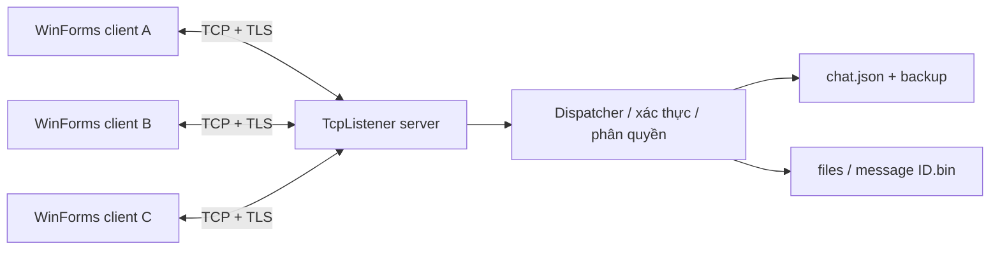

# Kiến trúc, giao thức và mô hình dữ liệu

## Luồng hệ thống



`TcpListener.AcceptTcpClientAsync` nhận các kết nối. Mỗi peer có một vòng nhận và một hàng đợi gửi riêng. Một client chậm không giữ khóa nghiệp vụ trong lúc server chờ gửi; hàng đợi đầy sẽ ngắt client đó. Server giới hạn 100 kết nối để phù hợp demo.

## Định dạng dây truyền

```
4 byte độ dài N, big-endian | N byte JSON UTF-8
```

Gói ví dụ (nằm bên trong TLS):

```json
{"type":"message.send","id":"request-unique-id","data":{"conversationId":"...","text":"Xin chào","clientId":"guid-cua-tin"},"ok":true,"error":null}
```

Request ID nối response với request đang đợi. `clientId` là ID nghiệp vụ riêng để server chống ghi trùng cùng một lần gửi. Tin có server ID tăng dần, sender và UTC timestamp do server gán. Client không thể giả sender bằng cách gửi một username khác.

Response dùng type `response`, cùng request ID, `ok=false` và `error` nếu bị từ chối. Event server có ID rỗng: `state`, `message`, `typing`, `read`, `notice`.

`ReadExactlyAsync` đọc đủ header và body, xử lý TCP phân mảnh/gộp khung. Kiểm tra N trước khi cấp phát, tối đa 8 MiB. JSON biểu diễn `byte[]` dạng Base64, nên giới hạn tệp là 5 MiB để vẫn vừa khung. Không phải cơ chế upload chunk hay resume; đang gửi tệp có thể làm tin text cùng kết nối phải chờ.

## Các lệnh

| Lệnh | Dữ liệu | Kiểm tra chính |
|---|---|---|
| register / login | Credentials | Username hợp lệ, mật khẩu 8–128 ký tự; giới hạn 20 lần xác thực/IP/phút |
| logout / sync / ping | object rỗng | Đã đăng nhập |
| friend.request / friend.remove | UserTarget | Người dùng tồn tại, không phải mình |
| friend.respond | FriendDecision | Đúng người nhận lời mời |
| direct.open | UserTarget | Tạo hoặc trả lại cuộc chat 1–1 hiện có |
| group.create | GroupCreate | Tên 1–60 ký tự, 2–50 thành viên hợp lệ |
| group.member | GroupMember | Chỉ owner, không xóa chính owner |
| message.send | SendMessage | Là thành viên, nội dung/tệp đúng giới hạn; dedupe clientId theo sender |
| history | HistoryQuery | Là thành viên, tìm kiếm tối đa 100 ký tự, trả 50 tin/lần |
| read | ReadRequest | Là thành viên, mốc tin có thật trong cuộc chat, cursor chỉ tiến |
| typing | TypingRequest | Là thành viên; không lưu xuống đĩa |
| download | FileRequest | Có quyền trong cuộc chat chứa tệp |

Tất cả lệnh bị giới hạn 40 lần/giây/kết nối. Đây là kiểm soát cơ bản cho đồ án, chưa phải biện pháp chống DoS toàn diện.

## Mô hình dữ liệu

- Account: Username, Salt, PasswordHash, Friends.
- FriendRequest: From, To.
- Conversation: Id, Name, IsGroup, Owner, Members, ReadThrough theo username.
- Message: Id, ConversationId, Sender, Text, SentAt, SeenBy, FileName, FileSize, ClientId.
- Database: SchemaVersion, NextMessageId, các danh sách trên.

Một tài khoản có thể đăng nhập nhiều cửa sổ. Online khi ít nhất một kết nối đã xác thực còn hoạt động. Khi đăng xuất, chỉ kết nối đó mất quyền; các cửa sổ khác không bị đăng xuất theo. Heartbeat 15 giây; server cắt kết nối đã đăng nhập nếu không đọc được khung hoàn chỉnh trong 75 giây. Socket đóng bình thường được nhận biết ngay; mất mạng vật lý có thể cần timeout.

## Đồng thời và tính nhất quán

1. Dispatcher lấy semaphore bảo vệ trạng thái nghiệp vụ.
2. Tạo bản sao trạng thái, xác thực quyền, thay đổi bản sao.
3. Ghi `chat.json.tmp`, flush, thay thế `chat.json`; giữ phiên bản trước tại `.bak`.
4. Cập nhật trạng thái trong RAM, enqueue response/event theo thứ tự.
5. Nhả semaphore. Các writer riêng thực hiện I/O mạng.

PBKDF2 chạy ngoài semaphore để tránh giữ khóa trong lúc băm. Khi đăng ký, uniqueness được kiểm tra lại trong khóa. Khóa file ngăn hai server cùng mở một thư mục dữ liệu. Nếu lưu lỗi, bản sao không được công bố và client nhận lỗi. Tệp upload có thể còn mồ côi nếu lưu metadata lỗi; chưa có tác vụ thu gom tệp mồ côi.

Không tự gửi lại tin khi request timeout vì server có thể đã lưu trước khi đứt mạng. Client giữ nội dung đang gõ; người dùng đăng nhập lại để kiểm tra lịch sử. Server hỗ trợ dedupe khi cùng `clientId` được gửi lại, nhưng UI hiện không giữ hàng đợi gửi qua nhiều phiên.

## UI và an toàn kết nối

Một receive loop đọc mọi response/event rồi chuyển event vào UI qua `BeginInvoke`. Request hoàn tất bằng `TaskCompletionSource` chạy continuation bất đồng bộ. Bộ đếm phiên tải lịch sử ngăn response của cuộc chat cũ đè lên cuộc chat mới. Tin realtime và lịch sử được hợp nhất theo ID.

`SslStream` mã hóa đường truyền. Chứng chỉ tự ký được giữ qua lần khởi động; client so SHA-256 của certificate với mã được người dùng lấy từ server. Không có callback chấp nhận mọi certificate. Máy local đọc fingerprint từ thư mục server của chính tài khoản Windows; LAN phải trao đổi mã qua kênh đáng tin cậy. Không có cơ chế CA/revocation/rotation tự động.

Mật khẩu lưu bằng PBKDF2-HMAC-SHA256, 600.000 vòng, salt ngẫu nhiên 16 byte, hash 32 byte; so sánh constant-time. TLS không mã hóa database trên đĩa và server đọc được tin nhắn để chuyển tiếp/lưu lịch sử. Chưa triển khai E2EE hay cơ chế quản lý khóa nhiều thiết bị.

## Giới hạn và hướng phát triển

JSON toàn bộ + snapshot toàn bộ phù hợp nhóm nhỏ, chưa tối ưu cho lịch sử lớn. Chuyển sang SQLite với transaction và index là bước tiếp theo; tiếp đó cursor pagination cho danh sách, delta events, lưu phiên với token hash + DPAPI, upload chunk, reconnect có backoff. Các cải tiến này được ghi là hướng phát triển, không tính là tính năng đã hoàn thành.
